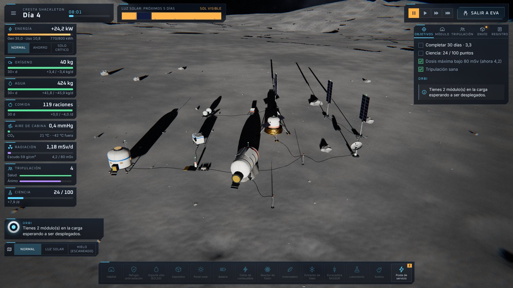
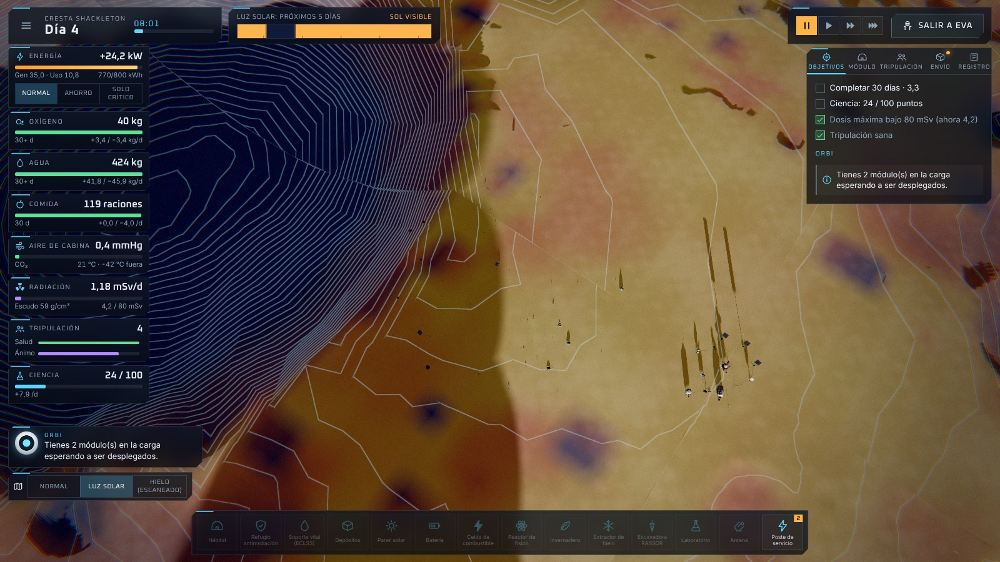
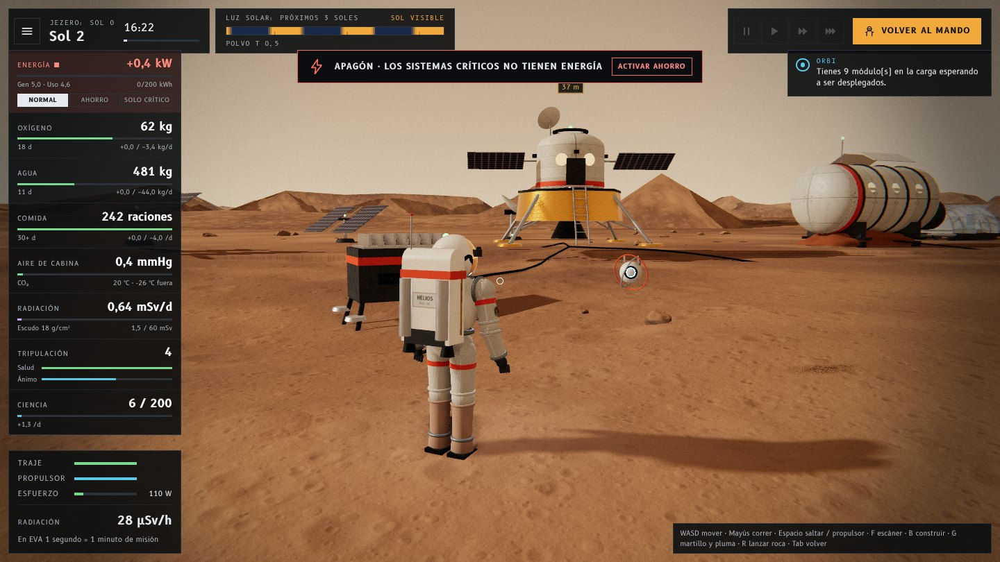
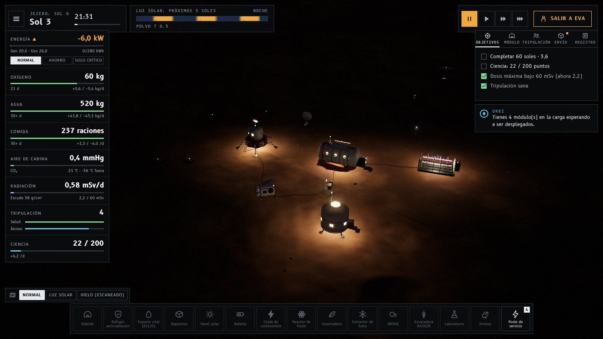
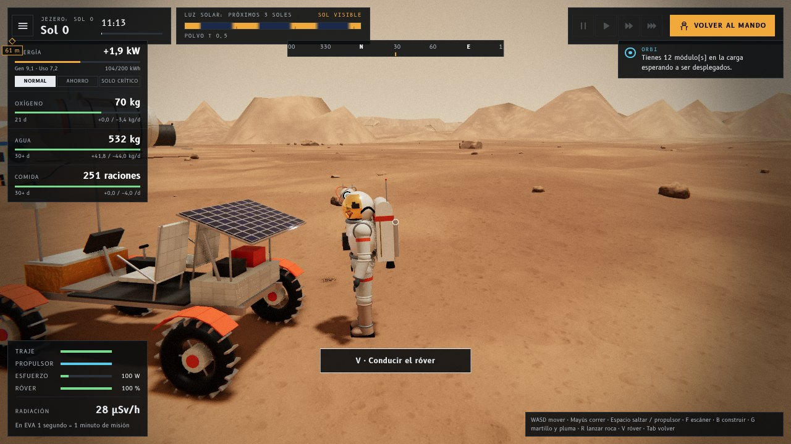

# Helios Outpost

**A mission trainer for junior astronauts** · NASA Space Apps Challenge 2026
Challenge: *Build a Junior Astronaut Mission Trainer* · Team **Los Chiiakawitas**

> The Sun gives you power… and puts you to the test.

Helios Outpost is a 3D game (desktop program or browser) in which you run an outpost at the **lunar south pole** or in a **Martian crater**. You decide what cargo to bring, where each module goes and how the crew spends its time, and you live with the consequences: a lunar night of almost three days, a Martian dust storm, a solar storm that arrives with a few hours' warning.

There is no single right answer. There are real engineering trade-offs — mass, power, life support, radiation, food — turned into something you can touch.

| | |
| --- | --- |
|  |  |
| *Shackleton ridge: the Sun grazes the horizon and shadows are hundreds of metres long.* | *Sunlight map: every spot has its own horizon. In blue, the permanent shadow where ice hides.* |
|  |  |
| *An EVA on Mars… during a blackout: two arrays are not enough when the Sun is weak.* | *Martian night: the reactors keep the power on and the greenhouse glows magenta.* |



*The rover: four wheels on independent suspension, its own battery and solar panel. It weighs less than on Earth but has the same mass: little grip and long stopping distances.*

*(Versión en español: [README.md](README.md).)*

---

## Play

There are three ways to open it, from the easiest to the most technical.

**1 · As a desktop program (recommended).** Helios Outpost is packaged as a real application for Windows, macOS and Linux: its own full-screen window, no browser bar, a *Quit* option in the menu and `F11` to toggle full screen.

- *Download a build:* on GitHub, **Actions → Desktop app → latest run → Artifacts**. `HeliosOutpost-windows` contains a portable `.exe` (no installation), `HeliosOutpost-macos` a `.dmg` and `HeliosOutpost-linux` an `.AppImage`. The binaries are not signed: Windows shows the SmartScreen warning (*More info → Run anyway*) and macOS asks you to open it with right-click → *Open*.
- *From the source:*

  ```bash
  npm install
  npm run app            # build and open the game in its own window
  npm run dist           # build the installer for your system in release/
  ```

**2 · Without installing anything:** download the repository and double-click **`helios-outpost.html`**. It is the whole game in one file (code, styles and fonts included); it works offline and fits on a USB stick.

> If you open `index.html` directly, the page sends you to `helios-outpost.html` on its own: the source code needs the development server, which a browser cannot run from disk.

**3 · To develop:**

```bash
npm install
npm start          # opens http://localhost:5173 with hot reload
```

It needs a browser with WebGL 2 (recent Chrome, Edge or Firefox). It plays with keyboard and mouse, a gamepad or a touch screen. **On tablets and Chromebooks** the game picks the *Minimal* quality by itself (lower resolution, 30 frames per second and none of the most expensive effects) and shows buttons for every EVA action — use, jump, scan, rover, run, throw, Galileo, build and camera — as well as drag, pinch and an on-screen joystick. While building, rotate and cancel buttons appear.

**Address parameters** (handy for preparing a class or a fair): `?m=<mission>` opens a mission straight away (for example `?m=moon-1970`), `?q=lite|low|medium|high|ultra` sets the quality, and `?demo=1` starts the demo mode (`?demo=loop` repeats it forever).

| Command | What it does |
| --- | --- |
| `npm start` / `npm run dev` | Development server |
| `npm run build` | Type-checks, builds `dist/index.html` (one file) and updates `helios-outpost.html` |
| `npm run build:web` | Also writes `dist-web/helios-outpost.html`, a version to publish as a page inside another site (for example claude.ai) |
| `npm run preview` | Serves the production build |
| `npm test` | Unit tests |
| `npm run app` / `npm run app:windowed` | Desktop program (full screen / windowed) |
| `npm run dist` | Desktop installer in `release/` (`dist:win`, `dist:mac`, `dist:linux` to pick a system) |

After changing the code, run `npm run build` so that `helios-outpost.html` stays up to date. `dist/index.html` is self-contained: it works the same on GitHub Pages, itch.io or any file server. The `.github/workflows/deploy.yml` workflow runs the tests, builds and publishes to GitHub Pages whenever `main` is updated (enable *Settings → Pages → Source: GitHub Actions*). The `.github/workflows/desktop.yml` workflow builds the desktop program for all three systems on every change to the game, and a `v*` tag attaches the files to a *Release*.

**If something fails to open**, the page says so on screen (for example, that the browser has no WebGL 2) instead of staying blank.

## How to play

1. **Choose a mission.** An 8-day training run on the Moon, 30 days on Shackleton ridge, 60 or 180 sols on Mars, or free play. Seven **historic scenarios** relive real events: two solar storms (Moon, August 1972; Mars, September 2017), the **Apollo 13 oxygen-tank explosion** (April 1970: at 55 h 55 min into the mission most of the oxygen is lost, the fuel cell dies and the CO₂ scrubbers fail, this time on the lunar surface), the **global dust storm of June 2018**, the one that silenced the Opportunity rover (the sky goes almost black for weeks), the **moonquake of March 1973** (the strongest the Apollo seismometers recorded, centred near the south pole, played on the connecting ridge), the **impact of 17 March 2013** (a meteoroid of about 40 kg whose flash was seen from Earth, now a stone's throw from the base) and the **Mir fire of February 1997**, retold in a base on Mars. Five places use **real terrain measured by NASA spacecraft**: four at the lunar south pole (Shackleton rim, the connecting ridge, Malapert massif and Nobile rim, measured by the LOLA laser altimeter) and the spot in Jezero where Perseverance landed (CTX camera). On the real lunar sites **the Sun moves as it really does there**, computed from each place's latitude: on the ridges next to the pole it never quite sets, and 4–5° from the pole there are nights of almost two weeks.
2. **Plan the cargo.** You have a mass limit. Water for the whole trip, or a machine that recycles it? Arrays or a reactor? A shelter or an excavator? ORBI, your assistant drone, tells you what is missing.
3. **Build the base** from the command console: modules connect themselves to the utility grid and the crew assembles them.
4. **Go outside (EVA).** Walk and jump in each world's real gravity, scan the ground for ice and samples, repair breakdowns, brush dust off the arrays. Drive the rover to go further on less suit: every mission has an **expedition** a kilometre from the base, further than a suit allows on foot there and back. Drop a hammer and a feather as on Apollo 15, or throw a rock and compare with what would have happened on Earth. Running drains the suit faster, and a hard fall damages it.
5. **Survive the events** and complete the goals. There are **emergencies with a countdown**: a pressure leak, a micrometeoroid puncture or a life-support failure give you a few minutes to choose between two responses with different consequences; if you do not decide, the crew acts on its own and more is lost. At the end, a debrief with telemetry explains which decisions shaped the mission, four comprehension questions check what was learned and a button downloads a **report for the teacher**.

**The campaign** (*The Helios programme*) puts nine missions in an order where each one teaches one idea, from a first night in the lander to a long stay on Mars. Each chapter opens when you complete the previous one and earns a bronze, silver or gold medal by score. Every mission is still open in *New mission*.

**Earth is far away.** Every mission has its radio delay: 1.3 s from the Moon; from Mars, between 3 and 22 minutes depending on where the two planets are (11.4 min on the day Perseverance landed; 20 min in September 2017, just after conjunction). In an emergency you can **ask Mission Control for help**: the answer brings a tested procedure that speeds up the fix, but it takes the signal's round trip plus the analysis, and the problem goes on meanwhile. On Mars the distance also weighs on morale: no conversations with home, only messages.

**Solar conjunction.** Every two years, seen from Earth, Mars passes behind the Sun and the radio goes quiet for about two weeks; the agencies stop sending commands to their spacecraft. In *Mars · long stay* it happens between sols 88 and 102, and the mission editor can add it to any Mars mission of 20 sols or more. While it lasts no solar-storm warnings arrive from Earth, Mission Control cannot be asked for help and morale feels it: the base is on its own.

**Inside.** In the inspector of the habitat, lab, greenhouse or lander, *Look inside* walks you into the module: bunks, galley, treadmill and lockers; workbench, glovebox and microscope; growing trays under magenta light whose plants grow with the harvest; seats and console. A wall screen shows live O₂, water, CO₂, power, dose and temperature. The crew sleeps at night, runs on the treadmill when exercise is on and stands up in an emergency; in a blackout the lights dim. `Esc` or `Tab` to leave.

**Catastrophes with real damage.** Besides breakdowns and emergencies there can be **meteoroid impacts** (their ejecta punctures hulls and shatters solar cells tens of metres away), **moonquakes and marsquakes** (dishes knocked off Earth, masts leaning, connectors shaken loose, cracks that end up opening), **fire aboard** (fight it with extinguishers, vent the module or put it out yourself), **battery thermal runaways** and **computers crashed by solar storms**. Each piece of damage is concrete: a hole so many millimetres across loses the air given by the physics of a jet leaving at the speed of sound (about 7 kg of air an hour through 5 mm), an array loses its share of broken cells, and a dish more than 6° off loses the link. You see them in 3D — holes with jets of ice crystals, cracks, soot, sparks, fresh craters with rays of ejecta — and each has its own repair. Crew members can be **injured** (bruises, fractures, burns, smoke) and stay off work until they heal. Training missions have no random catastrophes, and the Junior level has half as many.

**Spare parts.** Repairs use parts: carry crates of spares in the cargo, or choose the 3D printer as an upgrade. Without spares only simple fixes can be improvised — a small patch, a spliced cable — as the ISS crew did with the 2 mm hole in Soyuz MS-09 in 2018. When oxygen runs short, the crew seals off a module that is losing air.

**Minigames.** Seventeen short hands-on jobs based on real procedures, each with its real fact on screen: reconnect wires, tighten bolts in a star, find a leak by ultrasound and patch it, find it with a thermal camera, point a dish, swap broken cells, reboot a computer, clean a filter or an array, sow, harvest only what is ripe, level an instrument, put out a fire, drill without overheating the bit, purge valves in order, focus the microscope and name the mineral, give first aid, and hold the link while data is sent. They play with mouse, finger or keyboard, the mission pauses meanwhile, and they are simpler at the Junior level. Done well they give the best result; rushed, a repair is only half done.

**Daily tasks.** Every morning the base has a short list of chores, as on a space station: clean the air filter, check the hatch seals, send data to Earth, analyse a sample, balance the batteries, change the rig's drill bit, purge the valves, clean arrays, sow, harvest or give first aid. Doing them yourself — inside the modules or on EVA — gives a bonus; otherwise the crew does them when they fall due, at the cost of maintenance hours. Ripe crops wait for someone to pick them and empty trays for someone to sow.

**Mission Control requests.** During the mission Earth asks for jobs with a deadline and a science reward: set out a **seismometer** far from the base and level it (afterwards every quake or impact is worth science), place a **laser retroreflector** aimed at Earth, set up a **weather station** on Mars (dust storms are announced a sol earlier), drill a **rock core**, **inspect** a module with the thermal camera (if nobody does, the seal gives), take a **photo** for the public (Earth in the lunar sky or a Martian sunset) or complete a **harvest** for the Veggie experiment. *Go* plots the EVA route, and the instruments stay on the ground.

**Technology upgrades.** At 25, 50 and 75 % of the science goal, Control offers three real technologies and you pick one: triple-junction cells, 98 % water recovery, water walls round the bunks, a spare-part 3D printer, the xEMU suit backpack, tuned-spectrum LEDs, CAMRAS amine beds, an electrodynamic dust shield, seismic anchors, Whipple shields, thermal barriers between cells or metal-mesh wheels.

**Long-term health.** Low gravity takes bone (1–1.5 % a month on the ISS) and muscle. In the *Crew* tab you choose how much the crew exercises each day (none, 1 h, or 2 h as on the ISS): it protects body and morale, but costs work hours. The debrief estimates the months of rehabilitation the crew would need back home.

**EVA route planner.** In the command view, *EVA route → Plan* and click the ground to mark up to twelve waypoints. The planner works out distance, climb, steepest slope, how much suit you use on foot and by rover, how much battery, and whether the route respects the Apollo **walkback limit**: the rover was never driven further than the astronauts could walk back. On EVA the next waypoint is marked and ticked off on arrival.

**Return fuel** is made on site: the propellant plant turns water (from the ice extractor) into hydrogen and oxygen on the Moon, and into methane and oxygen on Mars, where the CO₂ in the air provides more than half the mass. Long missions ask you to fill the ascent vehicle's tanks; it is the longest resource chain in the base and competes with everything else for power and water.

**The crew** have names, faces and specialities, and each speciality matters: the engineer repairs 30 % faster, the botanist speeds up the crops, the geologist gets more science from samples, the medic speeds up recovery and the pilot speeds up assembly. If someone falls ill, their edge is lost. They speak on the radio when something in their field happens, and two of them go out to work on the modules that need it (and come in at night, during a solar storm or when you order shelter).

**Sound.** Everything is synthesised on the fly. The rover has an electric motor whose pitch rises with speed and wheels crunching on regolith; on the Moon it sounds muffled, because without air you only hear what comes through the seat. The generative music changes mood: calm by day, deeper and sparser at night, and tense, with a low pulse, during an emergency, an unsheltered solar storm or a blackout.

**Photo mode.** With `O` (or from the pause menu) time stops, the interface disappears and the camera flies free: field of view, exposure, filters (natural, black and white, film, contrast) and `Enter` to save a PNG.

**Accessibility.** In Settings: text size (90–150 %), a palette for red-green colour blindness (blue, yellow and orange from the Okabe–Ito palette; states also carry ▲ and ■ symbols, not just colour), ORBI's and the radio's messages read aloud with the system voice, and a standard game controller to move, drive, look around and use tools.

**Daily challenge and achievements.** Every day there is a short challenge whose world, events and two special conditions come from the date: everyone who plays the same code (for example `20261114`) gets exactly the same mission, so a whole class — or two classes in different schools — can compare scores. You can type another day's code to replay it. There are also 28 achievements (Galileo, lunar pitcher, cool head, ticket home, *A successful failure*, *Space firefighter*, *Handy*, Helios programme…) saved on the computer itself.

**Demo mode.** *Demo* in the main menu (or `?demo=1`) plays a short lunar mission by itself: it deploys and builds the base, goes on EVA to scan, shelters from a solar storm, handles an emergency and shows the debrief, with captions explaining each step. It presents the game in two minutes, or loops at a stand (`?demo=loop`). Any key, click or touch hands control back, and it does not count towards achievements.

**Four languages.** Spanish, English, Portuguese (Brazil) and French, including the science journal, the glossary, the quiz, the teacher report and the spoken warnings. The game follows the browser's language the first time and can be switched from the main menu or Settings.

**In the classroom:** three age levels (Junior 8–11, Cadet 12–14, Expert 15+) change the breakdowns and the questions; the science codex has a twenty-term glossary; and a [teacher guide](docs/TEACHER-GUIDE.md) offers four 45-minute sessions and discussion questions.

- **Mission editor for teachers** (in *New mission*): destination, length, crew, cargo budget, science goal, dose limit, solar and dust storms, emergencies, radio delay, return fuel, resupplies and real terrain. All of it fits in a **15-character code** (for example `H0022-EA4QK-BM0DN`) you write on the board: anyone who types it into *Your teacher's code* plays exactly that mission, with the same events. The last character is a check digit, so a mistyped code is caught.
- **Team mode**: 2 to 5 students share one computer. Each looks after one or two stations (power, life support, health and radiation, science, maintenance) and the controls rotate in shifts of 12 h, a day or three. At every change of shift the game stops: which goals each station met, who takes the controls and the goals for the next shift. Warnings carry the name of whoever should react ("Lucía → battery low"), and the debrief adds a team table.
- **Mission data as CSV**: from the debrief or the pause menu, *Download data (CSV)* saves the telemetry every few hours (power, oxygen, water, food, CO₂, dose, health, morale, science, temperature and sunlight) for charting in maths or science lessons. In Spanish, Portuguese and French it uses semicolons and decimal commas so the spreadsheet opens it correctly first time.
- **Class results** (only in the version published as a claude.ai page, which has a shared database): after a mission, *Send to the class* stores each student's best score for that mission. Whoever published the page sees under *Class results* a live table of everyone (name, result, score, peak dose, science and when it was sent) and can download it as CSV. Each student only sees and changes their own row, and only numbers and ids are sent, never text a student typed. To send, students need permission to take part in the page (*Contributor*); with view-only access the button says it could not send. In the desktop program and in `helios-outpost.html` the option does not appear.

### Controls

| Command mode | |
| --- | --- |
| `W A S D` / drag | Move the camera |
| Wheel · right button | Zoom · rotate |
| Click | Select a module / place |
| *EVA route* → click the ground · right-click | Add a waypoint · remove the last |
| `R` · `Esc` | Rotate · cancel building |
| `1` `2` `3` · `Space` | Time speed · pause |
| `M` | Change map (sunlight / ice) |
| `Tab` | Go out on EVA |

| EVA mode | |
| --- | --- |
| `W A S D` · `Shift` | Walk · run |
| `Space` | Jump; hold in the air: thruster |
| `F` | Scanner |
| `E` | Use: assemble, repair, clean, collect a sample, go in |
| `B` | Open the build menu |
| `G` | Galileo's experiment: drop a hammer and a feather together |
| `R` | Throw a rock (the camera aims: look up to throw higher) |
| `V` | Get into the rover (next to it) or out (stopped) |
| `O` | Photo mode (`Enter` captures, `Esc` leaves) |
| At the wheel: `W` `S` · `A` `D` · `Space` | Accelerate and reverse · steer · brake |
| `Tab` | Back to the base |

## The trade-offs it teaches

| Decision | What lies behind it |
| --- | --- |
| **Open or closed loop** | Without recycling each person uses 11 kg of water a day. An ECLSS weighs 1.1 t but recovers 95 %. On short missions carrying water wins; on long ones, recycling. |
| **Sun or fission** | At the lunar pole the Sun is almost always up, except when a mountain hides it for days. On Mars an array gives less than half as much and nothing at night. A reactor gives 10 kW at all times, but weighs 1.6 t and has to be far from the crew. |
| **Battery or fuel cell** | 95 % efficiency and little capacity, or half the efficiency and seven times more energy stored. |
| **Where to put the arrays** | Every spot on the map has its own horizon, computed from the real terrain: an array in a hollow spends half its life in shadow. |
| **Shelter or regolith** | The shelter protects from day one and weighs 1.3 t. The excavator weighs 0.4 t and buries the habitat over time: shielding and insulation from local material. |
| **Packaged food or greenhouse** | 30 m² of potatoes feed one person and their lights use more than 10 kW. Plants also give oxygen and morale, but take weeks. |
| **Distant ice** | On the Moon ice only survives in the crater's permanent shadow, far away, in the dark and at −180 °C. Power poles have to reach it. |
| **Work or take cover** | During a solar storm, sheltering avoids more than 90 % of the dose… and stops science, farming and assembly. |
| **Work pace** | An intense pace yields more for a while; then morale drops, and productivity with it. |
| **Driving in low gravity** | The rover weighs a sixth as much on the Moon, but its mass is the same: the wheels grip less and stopping takes far longer. |
| **Wait for Control or act now** | From Mars a question takes half an hour or more to be answered. Earth's procedure speeds up the fix, but the leak goes on meanwhile. |
| **Exercise or work** | Two hours of exercise a day hold back almost all the loss of bone and muscle… and are two hours less of assembly, science and maintenance. |
| **On foot or by rover** | On foot the suit gives about 1.7 km there and back on the flat, less uphill. The rover goes further, but only as far as you could walk back if it broke down. |
| **Pole or lower latitudes** | On the ridges next to the pole the Sun hardly sets, but it grazes the horizon. 120 km from the pole it climbs higher… and sets for almost two weeks. |
| **Preparing for the silence** | During solar conjunction nobody warns of storms or answers emergencies. Whatever is not ready beforehand — shelter, spares, spare power — will not arrive in time. |
| **Spare parts or more payload** | Every crate of spares is 40 kg that goes on nothing else. Without them, after an impact or a quake only simple fixes can be improvised; broken cells and burnt equipment wait. |
| **Fight it or vent it** | Fighting a fire with extinguishers keeps the module, but takes minutes of smoke and damage; emptying it of air puts the fire out at once, at the cost of that air and of the module until it is repaired. |

## Scientific rigour

Human consumables, measured surface radiation, gravity, solar irradiance, the length of the Martian sol, radio delays and dose limits are real values. The assumptions and the simplifications made to keep the simulator playable are documented with their sources in [`docs/SCIENCE.en.md`](docs/SCIENCE.en.md). In the game, the **Science codex** explains every system with data from real missions (Apollo, ISS, Curiosity, Perseverance/MOXIE, LCROSS, Kilopower, CHAPEA…).

## How it is made

Everything is procedural: there is not a single 3D model, texture or audio file in the repository.

```
src/
  sim/        Pure, serialisable simulation (no graphics), with tests
    sim.ts          power grid with priorities, life support, crops, radiation, crew
    environment.ts  Sun position, dust, temperature, particle storms
    missions.ts     scenarios, event schedule, scoring
    advisor.ts      ORBI's tips and the debrief lessons
    custom.ts       mission-editor codes (Crockford base 32 with a check digit)
    team.ts         team mode: stations, shifts and goals
    sites.ts        real-terrain sites: latitude and the Sun's path
    route.ts        EVA route planner and walkback limit
    csv.ts          telemetry export to CSV
    faults.ts       concrete damage, catastrophes, injuries and spare parts
    tasks.ts        daily tasks
    requests.ts     Mission Control requests and instruments
    upgrades.ts     technology upgrades
  world/      Analytic terrain (craters, massifs, dunes), quadtree LOD, sky, atmosphere, rocks
  render/     HDR pipeline (MSAA → ambient occlusion → bloom → ACES), environment reflections, materials, GPU particles
  entities/   Procedural models: 16 modules, astronaut in an articulated EVA suit, the ORBI drone
  game/       Loop, cameras, player, building, scanner, saving, module interiors, visible damage and craters
  audio/      Full Web Audio synthesis (ambience, tools, rover motor, generative music that follows the situation)
  ui/         Spanish, English, Portuguese and French interface (i18n/): menus, HUD, codex, debrief, minigames, demo mode, class results
tests/        Simulation tests (Vitest)
electron/     Desktop wrapper: window, full screen, quit (the page gets no Node.js access)
```

Technical details behind the design:

- **One terrain function** feeds the mesh, the physics, the shadows and the simulation. The horizon each solar array sees is computed by marching over that terrain; that is why what you see on screen is exactly what the power grid gets.
- **Long-range shadows** by ray-marching a height map in the shader, combined with a shadow map near the camera. With the Sun 5° above the horizon, shadows are hundreds of metres long.
- **Physical penumbra**: the Sun is a disc, not a point. Shadows are sharp where the object touches the ground and soften with distance according to the Sun's angular radius (0.27° on the Moon, 0.17° on Mars), using PCSS. The depth comparison follows the slope of the receiving surface, which allows a wide filter in grazing light without artefacts.
- **Computed, not painted, textures** (`src/render/surface.ts`): regolith with pebbles and micro-craters, paint with scratches and chips, brushed metal, crinkled insulation foil, rubber and stained fabric. Each map carries relief, roughness and tone, projected along three axes on every part, with no seams or UVs.
- **Opposition surge**: looking away from the Sun, regolith brightens around the antisolar point, as in the Apollo photos.
- **Martian air**: the haze brightens towards the Sun (dust scatters light forwards) and with a low Sun light shafts appear between the modules. None of this on the Moon: there is no air.
- **Helmet lamp with shadows** (high and ultra quality): at night every rock casts its own.
- **Rover with suspension** (`src/game/vehicle.ts`, no graphics, with tests): a rigid body on four wheels with independent springs and dampers. Each tyre can only push up to μ·N, where N is the load it carries: skids, long stops in low gravity and hops over bumps come out of that alone. The springs are sized for the local gravity.
- **Reflections of the real scene** (high and ultra): a cube camera photographs the surroundings from the commander's helmet, and that map, filtered, is what the visor, the metal and the arrays reflect. It also tints each part with the colour of the ground beneath it.
- **Volumetric light on Mars** (high and ultra): the dust in the air is lit step by step along every line of sight, checking the Sun's shadow map and the terrain. The shadow of the lander or of a crater rim shows in the air itself, and storms raise a dust layer that moves with the wind. Not applied on the Moon: there is no air to light.
- **One-bounce global illumination** (medium, high and ultra): two GPU passes over the height map work out where the Sun falls and, for every point, how much sky the terrain leaves open and how much sunlit ground it can see. Crater floors get less skylight, and shadows next to sunlit ground are filled with the light it bounces.
- **Real terrain** (`src/world/realTerrain.ts`): five 6.4 × 6.4 km crops of public elevation models, compressed inside the game itself (about 900 kB in all) and interpolated with cubic splines. Below the resolution of the data (5 m on the Moon, 20 m on Mars) generated roughness is added, because no spacecraft has measured finer detail. `scripts/real-terrain.py` reproduces the process from the original files: it picks the high, flat landing spot in each model and reads its latitude from the file's polar stereographic projection, which sets the Sun's path at that site (`src/sim/sites.ts`).
- **Own physics engine** (`src/game/physics.ts`, no graphics, with tests): each world's gravity, aerodynamic drag ½·ρ·Cd·A·v², wind, bounces with restitution, Coulomb friction and the energy loose ground absorbs. It moves thrown rocks and the hammer-and-feather experiment.
- **Deterministic, serialisable simulation**: a seed reproduces a mission; the state is JSON, which makes saving and testing trivial.
- **Dust by the physics**: on the Moon every grain follows a parabola; on Mars the air slows it and leaves it hanging.
- **Environment reflections without a single image**: a probe renders the sky and ground of each moment (Sun included) and filters them with PMREM; that is why the gold visor, the aluminium and the thermal blankets reflect the real landscape and change with the time of day.
- **Ambient occlusion (GTAO)** at high and ultra quality: joints, the gaps under modules and contact with the ground darken as in a photograph.
- **Articulated EVA suit**: rigid torso with a chest display, life-support backpack with hoses, bearing rings, bellows at elbows and knees, gloves with fingers, lugged boots and a gold visor. It leaves boot prints in the regolith.
- **Fractured rocks**: each stone is a deformed sphere cut by fracture planes, with mineral veins and fine dust settled on the faces that look up.
- **Dynamic resolution**: if the frame rate drops, the game lowers the render resolution automatically. The *Minimal* quality (the one tablets and modest Chromebooks pick by themselves) also caps the frame rate at 30 per second, to keep the device cool and save battery.

## Tests

`npm test` runs 146 tests in 22 files. Twenty-four cover the simulation: consumption rates against NASA reference values, power-grid priorities, the effect of dust and shielding, doses with and without shelter, harvests, whole missions with the recommended cargo and both historical scenarios (sheltering in time keeps the dose under the limit; not doing so does not). Six check the emergencies, three the expedition, twelve the physics engine against the formulas (fall time √(2h/g), terminal velocity, projectile range, wind drift, bounce losses, sliding on slopes) and ten the rover (static sag and load per wheel on both worlds, top speed, turning, traction, stopping distance against v²/(2·μ·g), slopes, obstacles and rough ground). The rest cover what was added later: editor codes (round trip, typo detection, missions that fit the budget and can be won), radio delay (1.3 s from the Moon, 11.4 min on Perseverance's date, the answer arrives after the round trip, waiting costs air), team mode (rotation, goals judged once, the clock waits for the handover), real sites (latitudes, the Sun never sets on the ridges and sets ~40 % of the month 4–5° from the pole, it moves westwards, the three new missions can be won), health (the Moon takes more than Mars, exercise protects but costs hours), the campaign (unlocks and medals), the route planner (its suit cost matches the game's, climbing costs the work of lifting 165 kg, dangerous slopes and the walkback limit), propellant, the daily challenge and the quiz, the two new historic scenarios (in June 2018 the optical depth reaches ~10.8 and a base with reactors rides it out while the same base on solar power alone does not; in the Apollo 13 accident the tank bursts at 55 h 55 min, the fuel cell dies, the scrubbers fail and a crew that uses the backup canisters gets everyone home), the solar conjunction (two weeks without Control or warnings from Earth, with an effect on morale; older editor codes still open the same mission), the CSV export (one row per sample, separator and decimal comma by language, a byte-order mark for accents), class results (numbers and ids only, each student in their own document, the best attempt kept, nothing written without an identity or permission) the languages (Portuguese and French cover all 1122 strings and keep the same `{placeholders}` as English), damage (a leak through a hole: about 7 kg of air an hour through 5 mm, four times that with twice the diameter, and a little over 1 kg through Soyuz MS-09's 2 mm; impacts shatter cells and puncture hulls; quakes knock the dish off and shake connectors loose; the crew repairs with spare parts and without them only improvises; fire grows if nobody acts, venting puts it out at once and putting it out by hand leaves nobody hurt; the catastrophe schedule follows from the seed and the three new missions can be won), tasks (a round every morning, the crew does those that fall due, harvesting by hand brings in more food, trays wait to be sown), requests (schedule, instruments that return science, a forgotten inspection opens a leak) and upgrades (the offer at milestones, triple-junction cells, the 3D printer).

## Credits and licences

- Graphics engine: [three.js](https://threejs.org/) (MIT). Typefaces: B612 and B612 Mono, designed for aircraft cockpits (SIL Open Font License), via Fontsource. Desktop program: [Electron](https://www.electronjs.org/) (MIT).
- Scientific data and facts: NASA and the publications cited in `docs/SCIENCE.en.md`.
- Real terrain: LOLA 5 m/px models of sites 01 (connecting ridge), 04 (Shackleton rim), 06 (Nobile rim) and 23 (Malapert massif) (NASA GSFC, Barker et al., 2021, doi:10.1016/j.pss.2020.105119) and the 20 m/px CTX mosaic of Jezero from the Mars 2020 mission (USGS Astrogeology, Fergason et al., 2020, doi:10.5066/P906QQT8). Public-domain data. This project is not affiliated with or endorsed by NASA.
- **Use of AI:** see the corresponding line in the Spanish [README.md](README.md#créditos-y-licencias), which is the team's own statement. No AI-generated images, 3D models or audio were used: all assets are created by code at run time.
