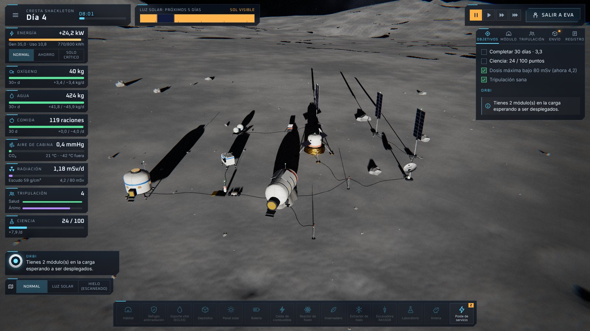
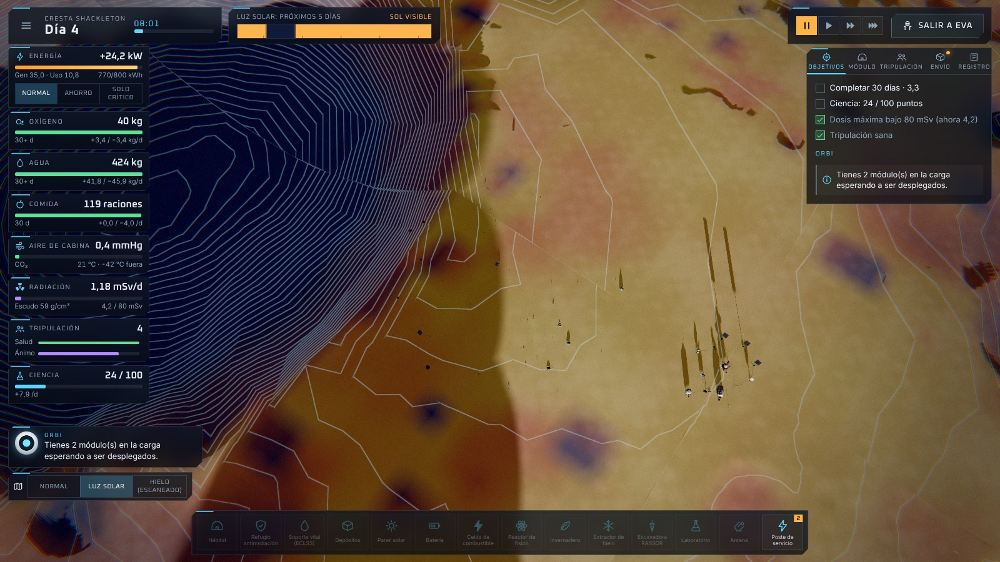
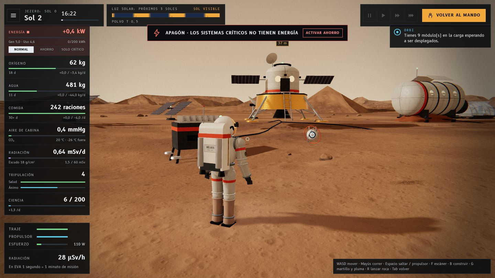
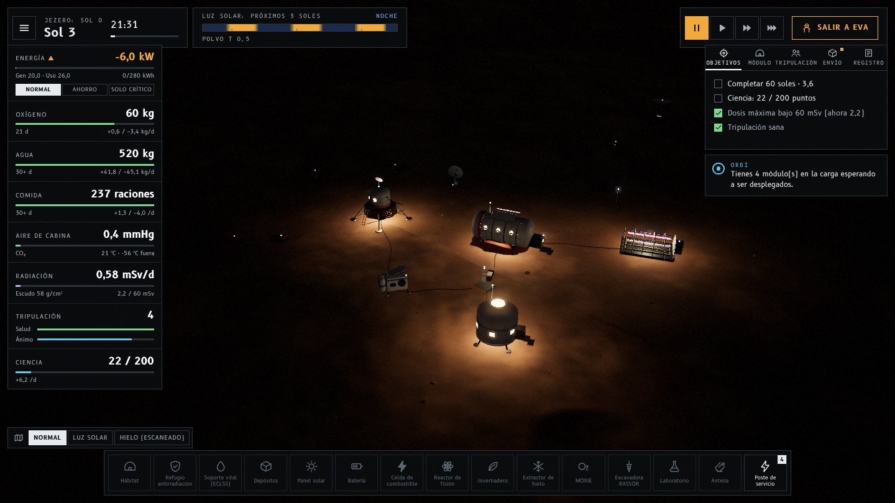
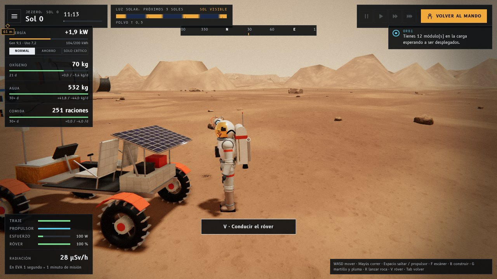

# Helios Outpost

**Simulador de misión para astronautas junior** · NASA Space Apps Challenge 2026
Reto: *Build a Junior Astronaut Mission Trainer* · Equipo **Los Chiiakawitas**

> El Sol te da energía… y te pone a prueba.

Helios Outpost es un juego 3D (programa de escritorio o navegador) en el que diriges un puesto avanzado en el **polo sur de la Luna** o en un **cráter de Marte**. Decides qué carga llevas, dónde colocas cada módulo y cómo reparte su tiempo la tripulación, y vives las consecuencias: una noche lunar de casi tres días, una tormenta de polvo marciana, una tormenta solar que llega con horas de aviso.

No hay una solución correcta. Hay disyuntivas de ingeniería reales —masa, energía, soporte vital, radiación, alimentos— convertidas en algo que se puede tocar.

| | |
| --- | --- |
|  |  |
| *Cresta Shackleton: el Sol roza el horizonte y las sombras miden cientos de metros.* | *Mapa de luz solar: cada punto tiene su propio horizonte. En azul, la sombra permanente donde se esconde el hielo.* |
|  |  |
| *EVA en Marte… con un apagón en curso: dos paneles no bastan cuando el Sol es débil.* | *Noche marciana: los reactores siguen dando energía y el invernadero brilla en magenta.* |



*El róver: cuatro ruedas con suspensión independiente, batería propia y panel solar. Pesa menos que en la Tierra, pero tiene la misma masa: agarra poco y tarda en frenar.*

*(English version: [README.en.md](README.en.md).)*

---

## Jugar

Hay tres formas de abrirlo, de la más cómoda a la más técnica.

**1 · Como programa de escritorio (recomendado).** Helios Outpost se empaqueta como una aplicación real para Windows, macOS y Linux: ventana propia a pantalla completa, sin barra de navegador, con opción *Salir* en el menú y `F11` para alternar la pantalla completa.

- *Descargar ya compilado:* en GitHub, pestaña **Actions → Desktop app → última ejecución → Artifacts**. `HeliosOutpost-windows` trae un `.exe` portátil (no necesita instalación), `HeliosOutpost-macos` un `.dmg` y `HeliosOutpost-linux` un `.AppImage`. Los binarios no están firmados: Windows mostrará el aviso de SmartScreen (*Más información → Ejecutar de todas formas*) y macOS pedirá abrirlo con clic derecho → *Abrir*.
- *Desde el código:*

  ```bash
  npm install
  npm run app            # compila y abre el juego en su propia ventana
  npm run dist           # genera el instalable de tu sistema en release/
  ```

**2 · Sin instalar nada:** descarga el repositorio y haz doble clic en **`helios-outpost.html`**. Es el juego completo en un solo archivo (código, estilos y tipografías incluidos); funciona sin conexión y se puede copiar a una memoria USB.

> Si abres `index.html` directamente, la página te lleva sola a `helios-outpost.html`: el código fuente necesita el servidor de desarrollo y un navegador no puede ejecutarlo desde el disco.

**3 · Para desarrollar:**

```bash
npm install
npm start          # abre http://localhost:5173 con recarga en caliente
```

Requiere un navegador con WebGL 2 (Chrome, Edge o Firefox recientes). Se juega con teclado y ratón, con mando o con pantalla táctil. **En tabletas y Chromebooks** el juego elige solo la calidad *Mínima* (menos resolución, 30 fotogramas por segundo y sin los efectos más caros) y muestra botones para todas las acciones de la EVA —usar, saltar, escanear, róver, correr, lanzar, Galileo, construir y cámara—, además de arrastrar, pellizcar y un joystick en pantalla. Al construir aparecen botones para girar y cancelar.

**Parámetros de la dirección** (útiles para preparar una clase o una feria): `?m=<misión>` abre directamente una misión (por ejemplo `?m=moon-1970`), `?q=lite|low|medium|high|ultra` fija la calidad, y `?demo=1` arranca el modo demostración (`?demo=loop` lo repite sin fin).

| Comando | Qué hace |
| --- | --- |
| `npm start` / `npm run dev` | Servidor de desarrollo |
| `npm run build` | Comprueba tipos, compila `dist/index.html` (un solo archivo) y actualiza `helios-outpost.html` |
| `npm run build:web` | Además genera `dist-web/helios-outpost.html`, una versión para publicar como página dentro de otro sitio (por ejemplo, claude.ai) |
| `npm run preview` | Sirve la compilación de producción |
| `npm test` | Pruebas unitarias de la simulación |
| `npm run app` / `npm run app:windowed` | Programa de escritorio (pantalla completa / en ventana) |
| `npm run dist` | Instalable de escritorio en `release/` (`dist:win`, `dist:mac`, `dist:linux` para elegir sistema) |

Tras cambiar el código, ejecuta `npm run build` para que `helios-outpost.html` quede al día. `dist/index.html` es autónomo: sirve igual en GitHub Pages, itch.io o cualquier servidor de archivos. El flujo `.github/workflows/deploy.yml` ejecuta las pruebas, compila y publica en GitHub Pages cada vez que se actualiza `main` (activa *Settings → Pages → Source: GitHub Actions*). El flujo `.github/workflows/desktop.yml` compila el programa de escritorio para los tres sistemas en cada cambio del juego, y una etiqueta `v*` adjunta los archivos a una *Release*.

**Si algo falla al abrir**, la página lo dice en pantalla (por ejemplo, que el navegador no tiene WebGL 2) en lugar de quedarse en blanco.

## Cómo se juega

1. **Elige misión.** Entrenamiento de 8 días en la Luna, 30 días en la cresta Shackleton, 60 o 180 soles en Marte, o modo libre. Cuatro **escenarios históricos** reviven sucesos reales: dos tormentas solares (Luna, agosto de 1972; Marte, septiembre de 2017), la **explosión del tanque de oxígeno del Apolo 13** (abril de 1970: a las 55 h 55 min de misión se pierde casi todo el oxígeno, cae la celda de combustible y fallan los depuradores de CO₂, ahora en la superficie lunar) y la **tormenta de polvo global de junio de 2018**, la que apagó el róver Opportunity (el cielo se queda casi negro durante semanas). Cinco lugares usan **relieve real medido por sondas de la NASA**: cuatro del polo sur lunar (borde de Shackleton, cresta de conexión, macizo de Malapert y borde de Nobile, medidos por el altímetro láser LOLA) y el punto de Jezero donde aterrizó Perseverance (cámara CTX). En los sitios lunares reales **el Sol se mueve como de verdad lo hace allí**, calculado a partir de la latitud de cada lugar: en las crestas junto al polo nunca llega a ponerse, y a 4–5° del polo hay noches de casi dos semanas.
2. **Planifica la carga.** Tienes un límite de masa. ¿Agua para todo el viaje o una máquina que la recicla? ¿Paneles o reactor? ¿Refugio o excavadora? ORBI, tu dron asistente, te avisa de lo que falta.
3. **Construye la base** desde la consola de mando: los módulos se conectan solos a la red de servicios y la tripulación los monta.
4. **Sal a la superficie (EVA).** Camina y salta con la gravedad real de cada mundo, escanea el terreno en busca de hielo y muestras, repara averías, limpia el polvo de los paneles. Conduce el róver para llegar más lejos gastando menos traje: cada misión tiene una **expedición** a un kilómetro de la base, más lejos de lo que un traje permite ir y volver a pie. Suelta un martillo y una pluma como en el Apolo 15, o lanza una roca y compara con lo que habría pasado en la Tierra. Correr gasta la reserva del traje más deprisa, y una caída dura lo daña.
5. **Sobrevive a los eventos** y completa los objetivos. Hay **emergencias con cuenta atrás**: una fuga de presión, la perforación de un micrometeorito o un fallo del soporte vital te dan unos minutos para elegir entre dos respuestas con consecuencias distintas; si no decides, la tripulación actúa sola y se pierde más. Al final, un informe con telemetría explica qué decisiones marcaron la misión, cuatro preguntas de comprensión comprueban lo aprendido y un botón descarga un **informe para el docente**.

**La campaña** (*Programa Helios*) ordena nueve misiones para que cada una enseñe una idea, de una primera noche en el módulo de descenso a una estancia larga en Marte. Cada capítulo se abre al completar el anterior y da medalla de bronce, plata u oro según la puntuación. Todas las misiones siguen abiertas en *Nueva misión*.

**La Tierra está lejos.** Cada misión tiene su retraso de radio: 1,3 s desde la Luna; desde Marte, entre 3 y 22 minutos según dónde estén los dos planetas (11,4 min el día que aterrizó Perseverance; 20 min en septiembre de 2017, justo después de la conjunción). En una emergencia se puede **pedir ayuda a Control**: la respuesta trae un procedimiento probado que acelera el arreglo, pero tarda la ida y vuelta de la señal más el análisis, y mientras tanto el problema sigue. En Marte, además, la distancia pesa en el ánimo: no hay conversaciones con casa, solo mensajes.

**Conjunción solar.** Cada dos años, visto desde la Tierra, Marte pasa por detrás del Sol y la radio se corta unas dos semanas; las agencias dejan de enviar órdenes a sus sondas. En *Marte · estancia larga* ocurre entre los soles 88 y 102, y el editor de misiones permite añadirla a cualquier misión marciana de 20 soles o más. Mientras dura no llegan desde la Tierra avisos de tormenta solar, no se puede pedir ayuda a Control y el ánimo lo nota: la base depende solo de sí misma.

**Por dentro.** En el inspector del hábitat, el laboratorio, el invernadero o el módulo de descenso, *Ver por dentro* entra en el módulo: literas, cocina, cinta de correr y taquillas; mesa de trabajo, guantera y microscopio; bandejas de cultivo bajo luz magenta cuyas plantas crecen con la cosecha; asientos y consola. Una pantalla de pared muestra en vivo O₂, agua, CO₂, energía, dosis y temperatura. La tripulación duerme de noche, corre en la cinta si hay ejercicio y se pone en pie en una emergencia; con un apagón, las luces bajan. `Esc` o `Tab` para salir.

**Salud a largo plazo.** En baja gravedad se pierde hueso (1–1,5 % al mes en la ISS) y músculo. En la pestaña *Tripulación* se elige cuánto ejercicio hace cada día la tripulación (nada, 1 h o 2 h como en la ISS): protege el cuerpo y el ánimo, pero resta horas de trabajo. El informe final estima los meses de rehabilitación que necesitaría la tripulación al volver.

**Planificador de rutas EVA.** En la vista de mando, *Ruta EVA → Planificar* y clic en el terreno para marcar hasta doce puntos de paso. El planificador calcula distancia, desnivel, pendiente máxima, cuánto traje se gasta a pie y en róver, cuánta batería y si se cumple el **límite de regreso a pie** de las misiones Apolo: el róver nunca debía alejarse más de lo que los astronautas podrían volver andando. Durante la EVA, el siguiente punto aparece marcado y se va tachando al llegar.

**El combustible de vuelta** se fabrica allí: la planta de propelente convierte agua (del extractor de hielo) en hidrógeno y oxígeno en la Luna, y en metano y oxígeno en Marte, donde el CO₂ del aire aporta más de la mitad de la masa. Las misiones largas piden llenar los tanques del vehículo de ascenso; es la cadena de recursos más larga de la base y compite por energía y agua con todo lo demás.

**La tripulación** tiene nombre, cara y especialidad, y cada especialidad cuenta: el ingeniero repara un 30 % más rápido, la botánica acelera los cultivos, el geólogo saca más ciencia de las muestras, la médica acelera la recuperación y el piloto agiliza el montaje. Si alguien enferma, su ventaja se pierde. Hablan por radio cuando pasa algo de su campo, y dos de ellos salen a trabajar a los módulos que lo necesitan (y se meten dentro de noche, con tormenta solar o cuando ordenas refugio).

**Sonido.** Todo se sintetiza en el momento. El róver tiene un motor eléctrico cuyo tono sube con la velocidad y ruido de ruedas sobre el regolito; en la Luna suena apagado, porque sin aire solo llega lo que transmite el asiento. La música generativa cambia de ánimo: tranquila de día, más grave y escasa de noche, y tensa, con un pulso grave, durante una emergencia, una tormenta solar sin refugio o un apagón.

**Modo foto.** Con `O` (o desde la pausa) el tiempo se detiene, la interfaz desaparece y la cámara vuela libre: campo de visión, exposición, filtros (natural, blanco y negro, película, contraste) e `Intro` para guardar la imagen en PNG.

**Accesibilidad.** En Ajustes: tamaño del texto (90–150 %), paleta para daltonismo rojo-verde (azul, amarillo y naranja de la paleta Okabe–Ito; los estados también llevan símbolos ▲ y ■, no solo color), lectura en voz alta de los avisos de ORBI y de la radio con la voz del sistema, y mando de consola estándar para mover, conducir, mirar y usar herramientas.

**Reto del día y logros.** Cada día hay un reto corto cuyo mundo, sucesos y dos condiciones especiales salen de la fecha: todo el que juegue el mismo código (por ejemplo, `20261114`) tiene exactamente la misma misión, así que una clase entera —o dos clases de colegios distintos— pueden comparar puntuaciones. Se puede escribir el código de otro día para repetirlo. Además hay 22 logros (como Galileo, brazo lunar, sangre fría, billete de vuelta, *Un fracaso con éxito* o Programa Helios…) que se guardan en el propio ordenador.

**Modo demostración.** *Demostración* en el menú principal (o `?demo=1`) juega sola una misión lunar corta: despliega y construye la base, sale de EVA a escanear, se refugia de una tormenta solar, resuelve una emergencia y enseña el informe final, con subtítulos que explican cada paso. Sirve para presentar el juego en dos minutos o dejarlo en bucle en un stand (`?demo=loop`). Cualquier tecla, clic o toque devuelve el control, y no cuenta para logros.

**Cuatro idiomas.** Español, inglés, portugués (Brasil) y francés, incluidas la bitácora científica, el glosario, las preguntas, el informe para el docente y la voz de los avisos. El juego elige el del navegador la primera vez y se cambia en el menú principal o en Ajustes.

**En el aula:** hay tres niveles por edad (Junior 8–11, Cadete 12–14, Experto 15+) que cambian las averías y las preguntas, un glosario de veinte términos en la bitácora científica y una [guía para docentes](docs/GUIA-DOCENTE.md) con cuatro sesiones de 45 minutos y preguntas para el debate.

- **Editor de misiones para docentes** (en *Nueva misión*): destino, duración, tripulación, carga, objetivo de ciencia, límite de dosis, tormentas solares y de polvo, emergencias, retraso de radio, combustible, reabastecimientos y terreno real. Todo cabe en un **código de 15 caracteres** (por ejemplo `H0022-EA4QK-BM0DN`) que se escribe en la pizarra: quien lo teclee en *Código de tu docente* juega exactamente esa misión, con los mismos sucesos. El último carácter es de control, así que un código mal copiado se detecta.
- **Modo por equipos**: de 2 a 5 estudiantes comparten un ordenador. Cada cual cuida uno o dos puestos (energía, soporte vital, salud y radiación, ciencia, mantenimiento) y los mandos rotan por turnos de 12 h, un día o tres. En cada cambio de turno el juego se para: qué objetivos cumplió cada puesto, quién toma los mandos y los objetivos del siguiente turno. Los avisos llevan el nombre de quien debe reaccionar («Lucía → batería baja»), y el informe final incluye una tabla del equipo.
- **Datos de la misión en CSV**: desde el informe final o la pausa, *Descargar datos (CSV)* guarda la telemetría cada pocas horas (energía, oxígeno, agua, comida, CO₂, dosis, salud, ánimo, ciencia, temperatura y luz solar) para hacer gráficas en clase de matemáticas o ciencias. En español, portugués y francés usa punto y coma y coma decimal, para que la hoja de cálculo lo abra bien a la primera.
- **Resultados de la clase** (solo en la versión publicada como página de claude.ai, que tiene base de datos compartida): al terminar una misión, *Enviar a la clase* guarda la mejor puntuación de cada estudiante en esa misión. Quien publicó la página ve en *Resultados de la clase* una tabla con todos (nombre, resultado, puntos, dosis máxima, ciencia y fecha de envío) que se actualiza sola y se descarga en CSV. Cada estudiante solo ve y cambia su propia fila, y solo se envían números e identificadores, nunca texto escrito por el estudiante. Para enviar, los estudiantes necesitan en la página permiso para participar (*Contributor*); con permiso de solo lectura el botón avisa de que no se pudo. En el programa de escritorio y en el archivo `helios-outpost.html` esta opción no aparece.

### Controles

| Modo Mando | |
| --- | --- |
| `W A S D` / arrastrar | Mover la cámara |
| Rueda · botón derecho | Zoom · girar |
| Clic | Seleccionar módulo / colocar |
| *Ruta EVA* → clic en el terreno · clic derecho | Añadir punto de paso · quitar el último |
| `R` · `Esc` | Rotar · cancelar construcción |
| `1` `2` `3` · `Espacio` | Velocidad del tiempo · pausa |
| `M` | Cambiar mapa (luz solar / hielo) |
| `Tab` | Salir a EVA |

| Modo EVA | |
| --- | --- |
| `W A S D` · `Mayús` | Caminar · correr |
| `Espacio` | Saltar; mantener en el aire: propulsor |
| `F` | Escáner |
| `E` | Usar: montar, reparar, limpiar, recoger muestra, entrar |
| `B` | Abrir el menú de construcción |
| `G` | Experimento de Galileo: soltar un martillo y una pluma a la vez |
| `R` | Lanzar una roca (la cámara apunta: mirar arriba la eleva) |
| `V` | Subir al róver (junto a él) o bajar (parado) |
| `O` | Modo foto (`Intro` captura, `Esc` sale) |
| Al volante: `W` `S` · `A` `D` · `Espacio` | Acelerar y retroceder · girar · frenar |
| `Tab` | Volver a la base |

## Las disyuntivas que enseña

| Decisión | Lo que hay detrás |
| --- | --- |
| **Ciclo abierto o cerrado** | Sin reciclaje, cada persona gasta 11 kg de agua al día. Un ECLSS pesa 1,1 t pero recupera el 95 %. En misiones cortas gana llevar agua; en largas, reciclar. |
| **Sol o fisión** | En la Luna polar el Sol casi siempre está, salvo cuando una montaña lo tapa durante días. En Marte un panel rinde menos de la mitad y nada de noche. Un reactor da 10 kW siempre, pero pesa 1,6 t y debe ir lejos de la tripulación. |
| **Batería o celda de combustible** | 95 % de eficiencia y poca capacidad, o la mitad de eficiencia y siete veces más energía almacenada. |
| **Dónde poner los paneles** | Cada punto del mapa tiene su propio horizonte, calculado sobre el terreno real: un panel en una hondonada pasa media vida en sombra. |
| **Refugio o regolito** | El refugio protege desde el primer día y pesa 1,3 t. La excavadora pesa 0,4 t y entierra el hábitat con el tiempo: blindaje y aislamiento térmico con material local. |
| **Comida envasada o invernadero** | 30 m² de papas alimentan a una persona y sus luces gastan más de 10 kW. Las plantas dan también oxígeno y ánimo, pero tardan semanas. |
| **Hielo lejano** | En la Luna el hielo solo sobrevive en la sombra permanente del cráter, lejos, a oscuras y a −180 °C. Hay que tender postes hasta allí. |
| **Trabajar o ponerse a cubierto** | Durante una tormenta solar, refugiarse evita más del 90 % de la dosis… y detiene la ciencia, el cultivo y el montaje. |
| **Ritmo de trabajo** | El ritmo intenso rinde más durante un tiempo; luego cae el ánimo y con él la productividad. |
| **Conducir en baja gravedad** | El róver pesa una sexta parte en la Luna, pero su masa es la misma: las ruedas agarran menos y frenar lleva mucha más distancia |
| **Esperar a Control o actuar ya** | Desde Marte una pregunta tarda media hora o más en tener respuesta. El procedimiento de la Tierra acelera el arreglo, pero mientras tanto la fuga sigue. |
| **Ejercicio o trabajo** | Dos horas diarias de ejercicio frenan casi toda la pérdida de hueso y músculo… y son dos horas menos de montaje, ciencia y mantenimiento. |
| **A pie o en róver** | Andando, el traje da para unos 1,7 km de ida y vuelta en llano, menos cuesta arriba. El róver llega más lejos, pero solo hasta donde se podría volver a pie si se averiara. |
| **Polo o latitudes medias** | En las crestas junto al polo el Sol casi no se pone, pero roza el horizonte. A 120 km del polo sube más… y se pone durante casi dos semanas. |
| **Prepararse para el silencio** | Durante la conjunción solar nadie avisa de las tormentas ni responde a las emergencias. Lo que no esté preparado antes —refugio, repuestos, energía de sobra— no llegará a tiempo. |

## Rigor científico

Los consumos humanos, la radiación medida en superficie, la gravedad, la irradiancia solar, la duración del sol marciano y los límites de dosis son valores reales. Los supuestos y las simplificaciones hechas para que el simulador sea jugable están documentados, con sus fuentes, en [`docs/SCIENCE.md`](docs/SCIENCE.md). Dentro del juego, la **Bitácora científica** explica cada sistema con datos de misiones reales (Apolo, ISS, Curiosity, Perseverance/MOXIE, LCROSS, Kilopower, CHAPEA…).

## Cómo está hecho

Todo es procedural: no hay un solo modelo 3D, textura o archivo de audio en el repositorio.

```
src/
  sim/        Simulación pura y serializable (sin gráficos), con pruebas
    sim.ts          red eléctrica con prioridades, soporte vital, cultivos, radiación, tripulación
    environment.ts  posición del Sol, polvo, temperatura, tormentas de partículas
    missions.ts     escenarios, calendario de eventos, puntuación
    advisor.ts      consejos de ORBI y lecciones del informe final
    custom.ts       códigos del editor de misiones (base 32 de Crockford con dígito de control)
    team.ts         modo por equipos: puestos, turnos y objetivos
    sites.ts        sitios con relieve real: latitud y trayectoria del Sol
    route.ts        planificador de rutas EVA y límite de regreso a pie
    csv.ts          exportación de la telemetría a CSV
  world/      Terreno analítico (cráteres, macizos, dunas), quadtree LOD, cielo, atmósfera, rocas
  render/     Canal HDR (MSAA → oclusión ambiental → bloom → ACES), reflejos del entorno, materiales, partículas en GPU
  entities/   Modelos procedurales: 16 módulos, astronauta con traje EVA articulado, dron ORBI
  game/       Bucle, cámaras, jugador, construcción, escáner, guardado, interiores de los módulos
  audio/      Síntesis completa con Web Audio (ambiente, herramientas, motor del róver, música generativa que cambia con la situación)
  ui/         Interfaz en español, inglés, portugués y francés (i18n/): menús, HUD, bitácora, informe, modo demostración, resultados de la clase
tests/        Pruebas de la simulación (Vitest)
electron/     Envoltorio de escritorio: ventana, pantalla completa, salir (la página no recibe acceso a Node.js)
```

Detalles técnicos que sostienen el diseño:

- **Una sola función de terreno** alimenta la malla, la física, las sombras y la simulación. El horizonte que ve cada panel solar se calcula marchando sobre ese terreno; por eso lo que se ve en pantalla es exactamente lo que cobra la red eléctrica.
- **Sombras de largo alcance** por *ray-marching* de un mapa de alturas en el sombreador, combinadas con un mapa de sombras cerca de la cámara. Con el Sol a 5° sobre el horizonte, las sombras miden cientos de metros.
- **Penumbra física**: el Sol es un disco, no un punto. Las sombras son nítidas donde el objeto toca el suelo y se difuminan con la distancia según el radio angular del Sol (0,27° en la Luna, 0,17° en Marte), con la técnica PCSS. La comparación de profundidad sigue la pendiente de la superficie que recibe la sombra, lo que permite un filtro ancho con luz rasante sin artefactos.
- **Texturas calculadas, no pintadas** (`src/render/surface.ts`): regolito con guijarros y microcráteres, pintura con rayaduras y desconchones, metal cepillado, lámina aislante arrugada, goma y tela manchada. Cada mapa lleva relieve, rugosidad y tono, y se proyecta en tres ejes sobre cada pieza, sin costuras ni UV.
- **Brillo de oposición**: mirando en dirección contraria al Sol, el regolito se aclara alrededor del punto antisolar, como en las fotos del Apolo.
- **Aire de Marte**: la neblina se ilumina hacia el Sol (el polvo dispersa la luz hacia delante) y con el Sol bajo aparecen haces de luz entre los módulos. En la Luna no hay nada de esto: no hay aire.
- **Lámpara del casco con sombras** (calidades alta y ultra): de noche cada roca proyecta la suya.
- **Róver con suspensión** (`src/game/vehicle.ts`, sin gráficos y con pruebas): un sólido rígido sobre cuatro ruedas con muelle y amortiguador independientes. Cada neumático solo puede empujar hasta μ·N, donde N es la carga que soporta: de ahí salen solos el derrape, las frenadas largas en baja gravedad y los saltos sobre los baches. Los muelles se dimensionan para la gravedad local.
- **Reflejos de la escena real** (calidades alta y ultra): una cámara cúbica fotografía el entorno desde el casco del comandante y ese mapa, filtrado, es lo que reflejan el visor, el metal y los paneles. Además tiñe las piezas con el color del suelo que tienen debajo.
- **Luz volumétrica en Marte** (alta y ultra): el polvo del aire se ilumina paso a paso a lo largo de cada línea de visión, consultando el mapa de sombras del Sol y el relieve. La sombra del módulo de descenso o de un borde de cráter se ve en el propio aire, y las tormentas levantan una capa de polvo que se mueve con el viento. En la Luna no se aplica: no hay aire que iluminar.
- **Iluminación global de un rebote** (media, alta y ultra): dos pasadas en la GPU sobre el mapa de alturas calculan dónde cae el Sol y, para cada punto, cuánto cielo deja libre el relieve y cuánto suelo iluminado tiene a la vista. Con eso el fondo de los cráteres recibe menos luz de cielo y las sombras junto a terreno soleado se rellenan con la luz que este devuelve.
- **Relieve real** (`src/world/realTerrain.ts`): cinco recortes de 6,4 × 6,4 km de modelos de elevación públicos, comprimidos dentro del propio juego (unos 900 kB en total) e interpolados con splines cúbicas. Por debajo de la resolución de los datos (5 m en la Luna, 20 m en Marte) se añade una rugosidad generada, porque ninguna sonda ha medido detalle más fino. El script `scripts/real-terrain.py` reproduce el proceso desde los archivos originales: elige en cada modelo el punto alto y llano donde aterrizar y lee su latitud de la proyección estereográfica polar del archivo, que es lo que fija la trayectoria del Sol en ese sitio (`src/sim/sites.ts`).
- **Motor de física propio** (`src/game/physics.ts`, sin gráficos y con pruebas): gravedad de cada mundo, arrastre aerodinámico ½·ρ·Cd·A·v², viento, rebote con restitución, fricción de Coulomb y la energía que absorbe el suelo suelto. Mueve las rocas lanzadas y el experimento del martillo y la pluma.
- **Simulación determinista y serializable**: una semilla reproduce una misión; el estado es JSON, lo que hace triviales el guardado y las pruebas.
- **Polvo según la física**: en la Luna cada grano sigue una parábola; en Marte el aire lo frena y lo deja flotando.
- **Reflejos del entorno sin una sola imagen**: una sonda genera el cielo y el suelo de cada instante (Sol incluido) y los filtra con PMREM; por eso el visor dorado, el aluminio y las mantas térmicas reflejan el paisaje real y cambian con la hora.
- **Oclusión ambiental (GTAO)** en las calidades alta y ultra: las juntas, los huecos bajo los módulos y el contacto con el suelo se oscurecen como en una foto.
- **Traje EVA articulado**: torso rígido con pantalla de pecho, mochila de soporte vital con mangueras, anillos de rodamiento, fuelles en codos y rodillas, guantes con dedos, botas con tacos y visor dorado. Deja huellas de bota en el regolito al caminar.
- **Rocas fracturadas**: cada piedra es una esfera deformada y cortada por planos de fractura, con vetas minerales y polvo fino posado en las caras que miran hacia arriba.
- **Resolución dinámica**: si la tasa de fotogramas cae, el juego baja la resolución de render automáticamente. En la calidad *Mínima* (la que eligen solas las tabletas y los Chromebooks modestos) además se limita a 30 fotogramas por segundo para no calentar el equipo ni gastar batería.

## Pruebas

`npm test` ejecuta 125 pruebas en 20 archivos. Veinticuatro cubren la simulación: tasas de consumo frente a los valores de referencia de NASA, prioridades de la red eléctrica, efecto del polvo y del blindaje, dosis con y sin refugio, cosechas, misiones completas con la carga recomendada y los dos escenarios históricos (refugiarse a tiempo mantiene la dosis bajo el límite; no hacerlo, no). Seis comprueban las emergencias: aislar para la fuga al momento, parchear mantiene el módulo pero cuesta más aire, no decidir sale caro, y los cartuchos de LiOH solo se pueden usar una vez. Tres comprueban que el objetivo de la expedición queda fuera del alcance a pie pero al alcance del róver, y que vale más ciencia. Doce cubren el motor de física frente a las fórmulas: tiempo de caída √(2h/g), velocidad terminal, alcance de un proyectil, deriva por el viento, pérdida de energía en los rebotes y deslizamiento en pendientes. Diez cubren el róver: hundimiento estático de la suspensión y carga por rueda en ambos mundos, velocidad máxima, giro, tracción, distancia de frenado frente a v²/(2·μ·g), pendientes, obstáculos y terreno irregular. El resto cubre lo añadido después: códigos del editor (ida y vuelta, detección de erratas, misiones que caben en el presupuesto y se pueden ganar), retraso de radio (1,3 s desde la Luna, 11,4 min en la fecha de Perseverance, la respuesta llega tras la ida y vuelta, esperar cuesta aire), modo por equipos (rotación, objetivos juzgados una vez, el reloj espera al relevo), sitios reales (latitudes, el Sol nunca se pone en las crestas y se pone ~40 % del mes a 4–5° del polo, se mueve hacia el oeste, las tres misiones nuevas se pueden ganar), salud (la Luna desgasta más que Marte, el ejercicio protege pero cuesta horas), campaña (desbloqueos y medallas), planificador de rutas (el coste en traje coincide con el del juego, la subida cuesta el trabajo de elevar 165 kg, pendientes peligrosas y límite de regreso a pie), propelente, reto del día y preguntas, los dos escenarios históricos nuevos (en junio de 2018 la profundidad óptica llega a ~10,8 y una base con reactores aguanta mientras la misma base solo con paneles no; en el accidente del Apolo 13 el tanque estalla a las 55 h 55 min, cae la celda de combustible, fallan los depuradores y una tripulación que usa los cartuchos de reserva vuelve entera), la conjunción solar (dos semanas sin Control ni avisos de la Tierra, con efecto en el ánimo; los códigos antiguos del editor siguen abriendo la misma misión), la exportación CSV (una fila por muestra, separador y coma decimal según el idioma, marca BOM para los acentos), los resultados de la clase (solo números e identificadores, cada estudiante en su propio documento, se guarda el mejor intento, sin identidad o sin permiso no se escribe nada) y los idiomas (portugués y francés cubren las 1122 cadenas y conservan los mismos `{marcadores}` que el inglés).

## Créditos y licencias

- Motor gráfico: [three.js](https://threejs.org/) (MIT). Tipografías: B612 y B612 Mono, diseñadas para cabinas de avión (SIL Open Font License), vía Fontsource. Programa de escritorio: [Electron](https://www.electronjs.org/) (MIT).
- Datos y hechos científicos: NASA y publicaciones citadas en `docs/SCIENCE.md`.
- Relieve real: modelos LOLA de 5 m/px de los sitios 01 (cresta de conexión), 04 (borde de Shackleton), 06 (borde de Nobile) y 23 (macizo de Malapert) (NASA GSFC, Barker et al., 2021, doi:10.1016/j.pss.2020.105119) y mosaico CTX de Jezero de 20 m/px de la misión Mars 2020 (USGS Astrogeology, Fergason et al., 2020, doi:10.5066/P906QQT8). Datos de dominio público. Este proyecto no está afiliado a NASA ni cuenta con su respaldo.
- **Uso de IA:** el código, los textos y el diseño se desarrollaron con la asistencia de un modelo de IA (Claude, de Anthropic) bajo la dirección del equipo de manera muy parcial (aprox. 15% del total). No se usaron imágenes, modelos 3D ni audio generados por IA: todos los recursos se crean por código en tiempo de ejecución.

---

## English summary

**Helios Outpost** is a 3D mission trainer for young students: command an outpost at the lunar south pole or in a Martian crater, plan the cargo within a mass budget, build the base, manage power, life support and radiation, walk and drive the surface, and ride out lunar nights, dust storms and solar storms. It includes a nine-chapter campaign, a mission editor for teachers with shareable codes, a team mode for the classroom, five sites on real NASA terrain with the Sun where it really is, the light-time delay to Earth, long-term health in low gravity and an EVA route planner. It also has Apollo 13 and the 2018 Martian dust storm as historic scenarios, the Mars solar-conjunction blackout, a walk-through interior for the main modules, an automatic demo mode, CSV telemetry export, shared class results for teachers (in the claude.ai page), tablet and Chromebook support, and four languages (Spanish, English, Portuguese and French). The full English documentation is in **[README.en.md](README.en.md)**, with a [teacher guide](docs/TEACHER-GUIDE.md) and the [science notes](docs/SCIENCE.en.md).
