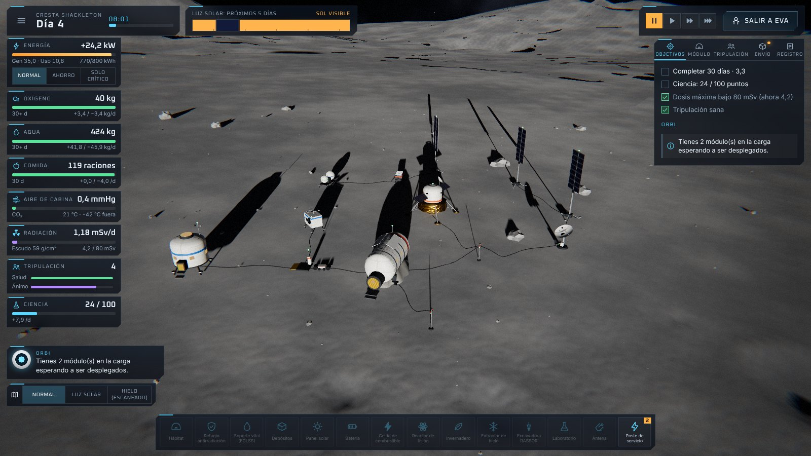
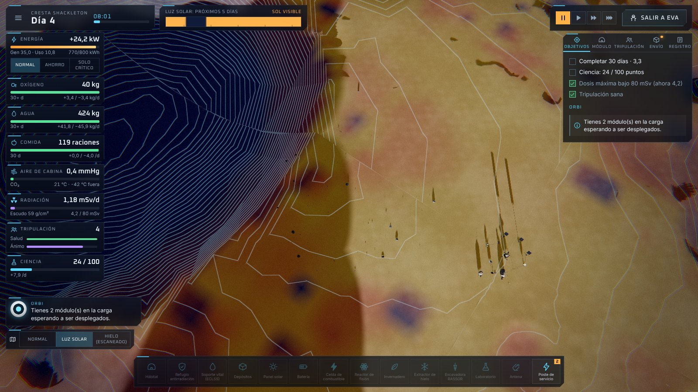
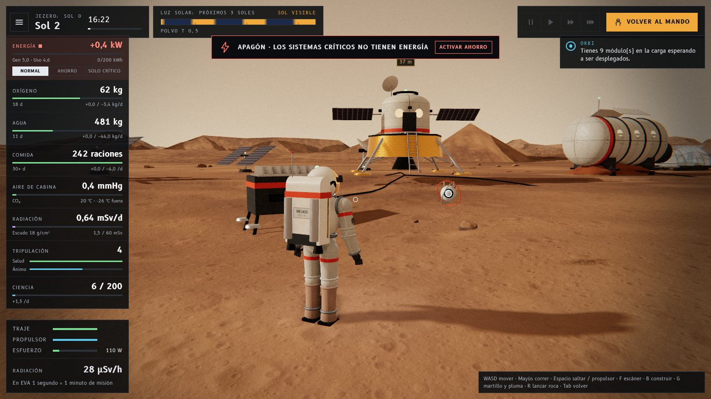
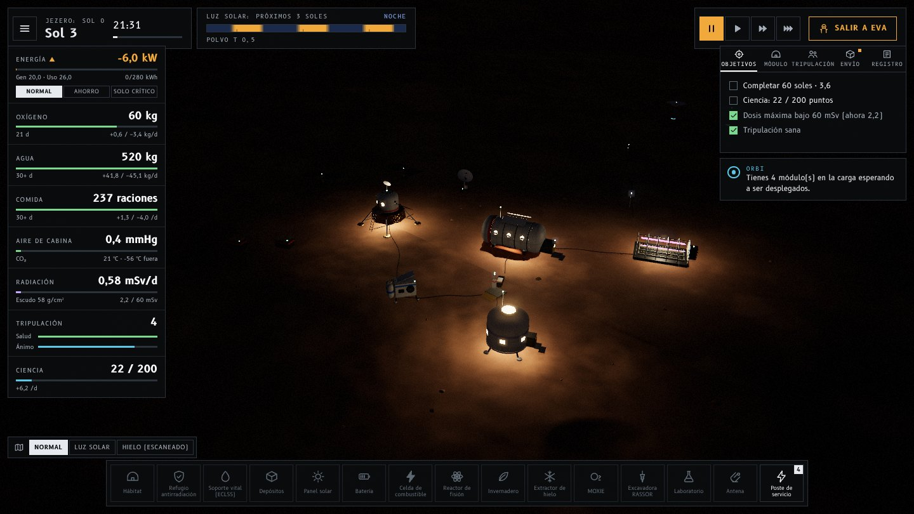

# Helios Outpost

**Simulador de misión para astronautas junior** · NASA Space Apps Challenge 2026
Reto: *Build a Junior Astronaut Mission Trainer* · Equipo **Los Chiiakawitas**

> El Sol te da energía… y te pone a prueba.

Helios Outpost es un juego 3D (programa de escritorio o navegador) en el que diriges un puesto avanzado en el **polo sur de la Luna** o en un **cráter de Marte**. Decides qué carga llevas, dónde colocas cada módulo y cómo reparte su tiempo la tripulación, y vives las consecuencias: una noche lunar de casi tres días, una tormenta de polvo marciana, una tormenta solar que llega con horas de aviso.

No hay una solución correcta. Hay disyuntivas de ingeniería reales —masa, energía, soporte vital, radiación, alimentos— convertidas en algo que se puede tocar.

| | |
| --- | --- |
|  |  |
| *Cresta Shackleton: el Sol roza el horizonte y las sombras miden cientos de metros.* | *Mapa de luz solar: cada punto tiene su propio horizonte. En azul, la sombra permanente donde se esconde el hielo.* |
|  |  |
| *EVA en Marte… con un apagón en curso: dos paneles no bastan cuando el Sol es débil.* | *Noche marciana: los reactores siguen dando energía y el invernadero brilla en magenta.* |

*(English summary at the end.)*

---

## Jugar

Hay tres formas de abrirlo, de la más cómoda a la más técnica.

**1 · Como programa de escritorio (recomendado).** Helios Outpost se empaqueta como una aplicación real para Windows, macOS y Linux: ventana propia a pantalla completa, sin barra de navegador, con opción *Salir* en el menú y `F11` para alternar la pantalla completa.

- *Descargar ya compilado:* en GitHub, pestaña **Actions → Desktop app → última ejecución → Artifacts**. `HeliosOutpost-windows` trae un `.exe` portátil (no necesita instalación), `HeliosOutpost-macos` un `.dmg` y `HeliosOutpost-linux` un `.AppImage`. Los binarios no están firmados: Windows mostrará el aviso de SmartScreen (*Más información → Ejecutar de todas formas*) y macOS pedirá abrirlo con clic derecho → *Abrir*.
- *Desde el código:*

  ```bash
  npm install
  npm run app            # compila y abre el juego en su propia ventana
  npm run dist           # genera el instalable de tu sistema en release/
  ```

**2 · Sin instalar nada:** descarga el repositorio y haz doble clic en **`helios-outpost.html`**. Es el juego completo en un solo archivo (código, estilos y tipografías incluidos); funciona sin conexión y se puede copiar a una memoria USB.

> Si abres `index.html` directamente, la página te lleva sola a `helios-outpost.html`: el código fuente necesita el servidor de desarrollo y un navegador no puede ejecutarlo desde el disco.

**3 · Para desarrollar:**

```bash
npm install
npm start          # abre http://localhost:5173 con recarga en caliente
```

Requiere un navegador con WebGL 2 (Chrome, Edge o Firefox recientes). Está pensado para teclado y ratón; en tabletas hay controles táctiles básicos (arrastrar, pellizcar, tocar, y joystick en pantalla durante las EVA).

| Comando | Qué hace |
| --- | --- |
| `npm start` / `npm run dev` | Servidor de desarrollo |
| `npm run build` | Comprueba tipos, compila `dist/index.html` (un solo archivo) y actualiza `helios-outpost.html` |
| `npm run preview` | Sirve la compilación de producción |
| `npm test` | Pruebas unitarias de la simulación |
| `npm run app` / `npm run app:windowed` | Programa de escritorio (pantalla completa / en ventana) |
| `npm run dist` | Instalable de escritorio en `release/` (`dist:win`, `dist:mac`, `dist:linux` para elegir sistema) |

Tras cambiar el código, ejecuta `npm run build` para que `helios-outpost.html` quede al día. `dist/index.html` es autónomo: sirve igual en GitHub Pages, itch.io o cualquier servidor de archivos. El flujo `.github/workflows/deploy.yml` ejecuta las pruebas, compila y publica en GitHub Pages cada vez que se actualiza `main` (activa *Settings → Pages → Source: GitHub Actions*). El flujo `.github/workflows/desktop.yml` compila el programa de escritorio para los tres sistemas en cada cambio del juego, y una etiqueta `v*` adjunta los archivos a una *Release*.

**Si algo falla al abrir**, la página lo dice en pantalla (por ejemplo, que el navegador no tiene WebGL 2) en lugar de quedarse en blanco.

## Cómo se juega

1. **Elige misión.** Entrenamiento de 8 días en la Luna, 30 días en la cresta Shackleton, 60 o 180 soles en Marte, o modo libre.
2. **Planifica la carga.** Tienes un límite de masa. ¿Agua para todo el viaje o una máquina que la recicla? ¿Paneles o reactor? ¿Refugio o excavadora? ORBI, tu dron asistente, te avisa de lo que falta.
3. **Construye la base** desde la consola de mando: los módulos se conectan solos a la red de servicios y la tripulación los monta.
4. **Sal a la superficie (EVA).** Camina y salta con la gravedad real de cada mundo, escanea el terreno en busca de hielo y muestras, repara averías, limpia el polvo de los paneles.
5. **Sobrevive a los eventos** y completa los objetivos. Al final, un informe con telemetría explica qué decisiones marcaron la misión.

### Controles

| Modo Mando | |
| --- | --- |
| `W A S D` / arrastrar | Mover la cámara |
| Rueda · botón derecho | Zoom · girar |
| Clic | Seleccionar módulo / colocar |
| `R` · `Esc` | Rotar · cancelar construcción |
| `1` `2` `3` · `Espacio` | Velocidad del tiempo · pausa |
| `M` | Cambiar mapa (luz solar / hielo) |
| `Tab` | Salir a EVA |

| Modo EVA | |
| --- | --- |
| `W A S D` · `Mayús` | Caminar · correr |
| `Espacio` | Saltar; mantener en el aire: propulsor |
| `F` | Escáner |
| `E` | Usar: montar, reparar, limpiar, recoger muestra, entrar |
| `B` | Abrir el menú de construcción |
| `Tab` | Volver a la base |

## Las disyuntivas que enseña

| Decisión | Lo que hay detrás |
| --- | --- |
| **Ciclo abierto o cerrado** | Sin reciclaje, cada persona gasta 11 kg de agua al día. Un ECLSS pesa 1,1 t pero recupera el 95 %. En misiones cortas gana llevar agua; en largas, reciclar. |
| **Sol o fisión** | En la Luna polar el Sol casi siempre está, salvo cuando una montaña lo tapa durante días. En Marte un panel rinde menos de la mitad y nada de noche. Un reactor da 10 kW siempre, pero pesa 1,6 t y debe ir lejos de la tripulación. |
| **Batería o celda de combustible** | 95 % de eficiencia y poca capacidad, o la mitad de eficiencia y siete veces más energía almacenada. |
| **Dónde poner los paneles** | Cada punto del mapa tiene su propio horizonte, calculado sobre el terreno real: un panel en una hondonada pasa media vida en sombra. |
| **Refugio o regolito** | El refugio protege desde el primer día y pesa 1,3 t. La excavadora pesa 0,4 t y entierra el hábitat con el tiempo: blindaje y aislamiento térmico con material local. |
| **Comida envasada o invernadero** | 30 m² de papas alimentan a una persona y sus luces gastan más de 10 kW. Las plantas dan también oxígeno y ánimo, pero tardan semanas. |
| **Hielo lejano** | En la Luna el hielo solo sobrevive en la sombra permanente del cráter, lejos, a oscuras y a −180 °C. Hay que tender postes hasta allí. |
| **Trabajar o ponerse a cubierto** | Durante una tormenta solar, refugiarse evita más del 90 % de la dosis… y detiene la ciencia, el cultivo y el montaje. |
| **Ritmo de trabajo** | El ritmo intenso rinde más durante un tiempo; luego cae el ánimo y con él la productividad. |

## Rigor científico

Los consumos humanos, la radiación medida en superficie, la gravedad, la irradiancia solar, la duración del sol marciano y los límites de dosis son valores reales. Los supuestos y las simplificaciones hechas para que el simulador sea jugable están documentados, con sus fuentes, en [`docs/SCIENCE.md`](docs/SCIENCE.md). Dentro del juego, la **Bitácora científica** explica cada sistema con datos de misiones reales (Apolo, ISS, Curiosity, Perseverance/MOXIE, LCROSS, Kilopower, CHAPEA…).

## Cómo está hecho

Todo es procedural: no hay un solo modelo 3D, textura o archivo de audio en el repositorio.

```
src/
  sim/        Simulación pura y serializable (sin gráficos), con pruebas
    sim.ts          red eléctrica con prioridades, soporte vital, cultivos, radiación, tripulación
    environment.ts  posición del Sol, polvo, temperatura, tormentas de partículas
    missions.ts     escenarios, calendario de eventos, puntuación
    advisor.ts      consejos de ORBI y lecciones del informe final
  world/      Terreno analítico (cráteres, macizos, dunas), quadtree LOD, cielo, atmósfera, rocas
  render/     Canal HDR (MSAA → oclusión ambiental → bloom → ACES), reflejos del entorno, materiales, partículas en GPU
  entities/   Modelos procedurales: 16 módulos, astronauta con traje EVA articulado, dron ORBI
  game/       Bucle, cámaras, jugador, construcción, escáner, guardado
  audio/      Síntesis completa con Web Audio (ambiente, herramientas, música generativa)
  ui/         Interfaz en español e inglés: menús, HUD, bitácora, informe
tests/        Pruebas de la simulación (Vitest)
electron/     Envoltorio de escritorio: ventana, pantalla completa, salir (la página no recibe acceso a Node.js)
```

Detalles técnicos que sostienen el diseño:

- **Una sola función de terreno** alimenta la malla, la física, las sombras y la simulación. El horizonte que ve cada panel solar se calcula marchando sobre ese terreno; por eso lo que se ve en pantalla es exactamente lo que cobra la red eléctrica.
- **Sombras de largo alcance** por *ray-marching* de un mapa de alturas en el sombreador, combinadas con un mapa de sombras clásico cerca de la cámara. Con el Sol a 5° sobre el horizonte, las sombras miden cientos de metros.
- **Simulación determinista y serializable**: una semilla reproduce una misión; el estado es JSON, lo que hace triviales el guardado y las pruebas.
- **Polvo según la física**: en la Luna cada grano sigue una parábola; en Marte el aire lo frena y lo deja flotando.
- **Reflejos del entorno sin una sola imagen**: una sonda genera el cielo y el suelo de cada instante (Sol incluido) y los filtra con PMREM; por eso el visor dorado, el aluminio y las mantas térmicas reflejan el paisaje real y cambian con la hora.
- **Oclusión ambiental (GTAO)** en las calidades alta y ultra: las juntas, los huecos bajo los módulos y el contacto con el suelo se oscurecen como en una foto.
- **Traje EVA articulado**: torso rígido con pantalla de pecho, mochila de soporte vital con mangueras, anillos de rodamiento, fuelles en codos y rodillas, guantes con dedos, botas con tacos y visor dorado. Deja huellas de bota en el regolito al caminar.
- **Rocas fracturadas**: cada piedra es una esfera deformada y cortada por planos de fractura, con vetas minerales y polvo fino posado en las caras que miran hacia arriba.
- **Resolución dinámica**: si la tasa de fotogramas cae, el juego baja la resolución de render automáticamente.

## Pruebas

`npm test` ejecuta 22 pruebas sobre la simulación: tasas de consumo frente a los valores de referencia de NASA, prioridades de la red eléctrica, efecto del polvo y del blindaje, dosis con y sin refugio, cosechas, y misiones completas con la carga recomendada.

## Créditos y licencias

- Motor gráfico: [three.js](https://threejs.org/) (MIT). Tipografías: B612 y B612 Mono, diseñadas para cabinas de avión (SIL Open Font License), vía Fontsource. Programa de escritorio: [Electron](https://www.electronjs.org/) (MIT).
- Datos y hechos científicos: NASA y publicaciones citadas en `docs/SCIENCE.md`. Este proyecto no está afiliado a NASA ni cuenta con su respaldo.
- **Uso de IA:** el código, los textos y el diseño se desarrollaron con la asistencia de un modelo de IA (Claude, de Anthropic) bajo la dirección del equipo. No se usaron imágenes, modelos 3D ni audio generados por IA: todos los recursos se crean por código en tiempo de ejecución.

---

## English summary

**Helios Outpost** is a browser-based 3D mission trainer for young students. You command an outpost at the lunar south pole or in a Martian crater: plan the cargo within a mass budget, place modules on procedurally generated terrain, allocate crew time, walk the surface on EVA, and ride out long lunar nights, Martian dust storms and solar particle events. A debrief with telemetry explains which engineering trade-offs decided the mission.

Human consumables, measured surface radiation, gravity, solar irradiance and dose limits are real figures; simplifications are listed with sources in [`docs/SCIENCE.md`](docs/SCIENCE.md). The interface is fully bilingual (Spanish / English). Everything — terrain, models, textures, sound — is generated by code at run time.

It runs as a desktop program (`npm run app`, or the Windows / macOS / Linux builds produced by the *Desktop app* workflow under Actions → Artifacts) or straight from disk: download the repository and double-click `helios-outpost.html` (the whole game in one self-contained file).

```bash
npm install && npm start       # develop at http://localhost:5173
npm test                       # simulation unit tests
npm run build                  # single-file build in dist/ and helios-outpost.html
npm run app                    # desktop program in its own full-screen window
npm run dist                   # packaged desktop build in release/
```
